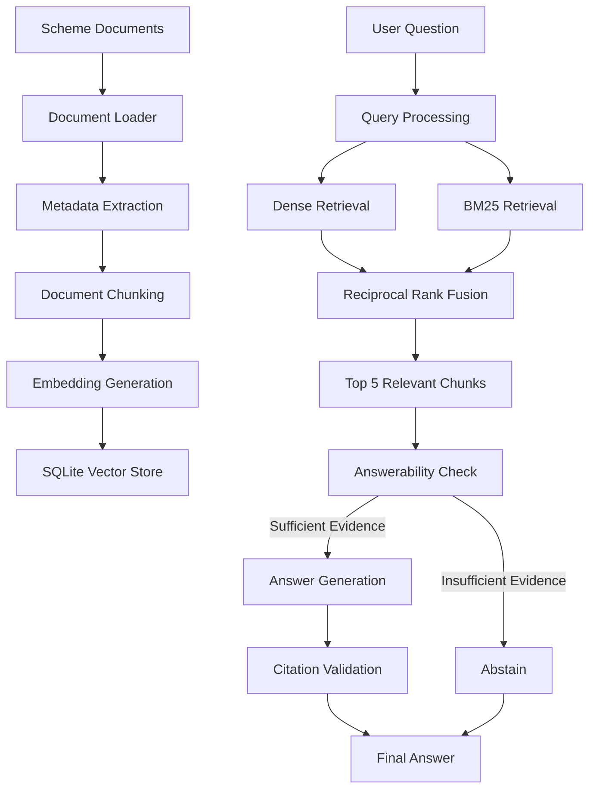

# SchemeSaathi – RAG Learning

### A Retrieval-Augmented Generation (RAG) system for Indian Government Welfare Schemes

SchemeSaathi is a Python-based RAG application that answers questions about Indian government welfare schemes using a collection of scheme documents. It retrieves relevant information, provides source citations, and abstains from answering when sufficient evidence is unavailable.

The project is built from scratch to make every stage of the RAG pipeline understandable.

<p align="center">


</p>

---

## Table of Contents

- [Problem Statement](#problem-statement)
- [Project Overview](#project-overview)
- [Key Features](#key-features)
- [Example](#example)
- [System Architecture](#system-architecture)
- [Technology Stack](#technology-stack)
- [Project Structure](#project-structure)
- [Installation](#installation)
- [Usage](#usage)
- [Evaluation Results](#evaluation-results)
- [RAG Pipeline](#rag-pipeline)
- [Design Decisions](#design-decisions)
- [Future Enhancements](#future-enhancements)
- [Limitations](#limitations)
- [Disclaimer](#disclaimer)

---

## Problem Statement

India has thousands of central and state government welfare schemes. However, many eligible citizens struggle to identify schemes, understand eligibility conditions, and find application procedures.

The information is often distributed across multiple PDF documents and government websites, making it difficult to access.

SchemeSaathi addresses this problem through a document-based question-answering system that allows users to ask questions in simple language.

## Project Overview

SchemeSaathi uses Retrieval-Augmented Generation (RAG) to retrieve relevant information from government welfare scheme documents.

Users can ask questions such as:

> I am an SC student pursuing B.Com, and my family income is ₹1.8 lakh. Am I eligible for a scholarship?

The system retrieves relevant passages and generates an answer based on available information.

If the retrieved documents do not contain sufficient evidence, the system can refuse to answer rather than guess.

### Main Objectives

- Make government scheme information easier to access.
- Retrieve relevant information from scheme documents.
- Provide answers with source references.
- Reduce unsupported or misleading answers.
- Demonstrate the complete RAG pipeline from ingestion to evaluation.

---

## Key Features

### 1. Document Ingestion
- Loads scheme documents in Markdown format.
- Extracts document metadata.
- Processes documents into structured chunks.

### 2. Hybrid Search
- Combines dense vector retrieval and BM25 keyword search.
- Uses Reciprocal Rank Fusion (RRF).
- Improves retrieval of scheme names, abbreviations, and numerical information.

### 3. Metadata Filtering
- Supports filtering based on rural and urban categories.
- Supports scheme-category filtering.
- Restricts retrieval to relevant documents.

### 4. Citation-Based Answers
- Includes source references such as `[S1]`, `[S2]`.
- Validates citations against available sources.
- Helps users identify the supporting document.

### 5. Abstention Mechanism
- Detects questions that cannot be answered from the available documents.
- Returns an explicit "I could not answer that" response.
- Avoids presenting unsupported information as fact.

### 6. Evaluation Framework
- Includes a labelled question dataset.
- Measures retrieval quality and answer grounding.
- Tests whether the system answers or refuses appropriately.

### 7. Local Execution
- Runs locally on a computer.
- Does not require an API key in its default configuration.
- Uses SQLite for storage.

---

## Example

### Example 1: Answerable Question

**Question:**
```text
How much does PM-KISAN pay and who is excluded?
```

**Response:**

The PM-KISAN scheme provides ₹6,000 per year in three equal instalments of ₹2,000 each, directly into the bank account of the farmer family.

The system also identifies excluded categories based on the available scheme documents.

**Sources:** `[S1]`, `[S3]`

### Example 2: Unanswerable Question

**Question:**
```text
What is the capital of France?
```

**Response:**

```text
I could not answer that from the documents I have.
```

The system does not attempt to answer unrelated questions using unsupported information.

---

## System Architecture

### RAG Pipeline



### Two Main Phases

**Phase 1 – Ingestion**

1. Read scheme documents.
2. Extract document metadata.
3. Split documents into meaningful chunks.
4. Generate embeddings.
5. Store text, metadata, and vectors in SQLite.

**Phase 2 – Question Answering**

1. Receive a user question.
2. Perform dense and keyword retrieval.
3. Combine results using Reciprocal Rank Fusion.
4. Select the top five relevant passages.
5. Check whether sufficient evidence exists.
6. Generate an answer or abstain.
7. Validate source citations.

---

## Technology Stack

| Technology | Purpose |
|---|---|
| Python 3.9+ | Core application |
| NumPy | Vector operations |
| SQLite | Local data storage |
| Streamlit | Web interface |
| BM25 | Keyword retrieval |
| Embeddings | Semantic retrieval |
| Pytest | Unit testing |

**Architecture:** Custom-built RAG pipeline without LangChain, LlamaIndex, or a separate vector database server.

---

## Project Structure

```text
RAG-learning/
│
├── app.py                  # Streamlit web application
├── ask.py                  # Question-answering CLI
├── ingest.py               # Document ingestion
├── config.py               # Configuration settings
├── requirements.txt        # Python dependencies
├── .env.example            # Example environment variables
│
├── rag/
│   ├── loaders.py          # Document loading
│   ├── chunker.py          # Document chunking
│   ├── embedder.py         # Embedding generation
│   ├── bm25.py             # Keyword retrieval
│   ├── store.py            # SQLite vector storage
│   ├── retrieve.py         # Retrieval and ranking
│   ├── llm.py              # LLM integrations
│   ├── generate.py         # Answer generation
│   └── pipeline.py         # Main RAG pipeline
│
├── data/
│   ├── schemes/            # Scheme documents
│   └── index/              # Generated index
│
├── eval/
│   ├── questions.jsonl     # Evaluation questions
│   └── run_eval.py         # Evaluation script
│
├── tests/
│   └── test_rag.py         # Unit tests
│
├── LEARN.md                # Seven-day RAG learning guide
└── README.md
```

---

## Installation

### Prerequisites

- Python 3.9 or later
- Git
- pip

### 1. Clone the Repository

```bash
git clone https://github.com/KiranJITdesign/RAG-learning.git
```

### 2. Navigate to the Project

```bash
cd RAG-learning
```

### 3. Create a Virtual Environment

**Windows:**

```powershell
python -m venv venv
venv\Scripts\activate
```

**Linux / macOS:**

```bash
python3 -m venv venv
source venv/bin/activate
```

### 4. Install Dependencies

```bash
pip install -r requirements.txt
```

### 5. Build the Search Index

```bash
python ingest.py
```

---

## Usage

### Ask Questions Through the Command Line

```bash
python ask.py "I am a small farmer, what financial support is available?"
```

### Enable Debug Mode

```bash
python ask.py --debug "How many days of work does MGNREGA guarantee?"
```

### Run the Web Application

```bash
streamlit run app.py
```

### Run Unit Tests

```bash
python -m pytest -q
```

### Run the Evaluation

```bash
python eval/run_eval.py
```

---

## Evaluation Results

The following results are reported by the project's evaluation dataset using the hashing embedder, extractive mode, top-k of 5, and 60 chunks.

| Evaluation Metric | Result |
|---|---:|
| Hit@5 | 100% (23/23) |
| Mean Reciprocal Rank (MRR) | 1.000 |
| Answer / Abstain Accuracy | 93% (28/30) |
| Key Fact Present | 83% (19/23) |
| Citation Grounding | 100% (23/23) |

### What These Metrics Mean

- **Hit@5:** Whether the relevant document appears in the top five retrieved results.
- **MRR:** How highly the first relevant result is ranked.
- **Answer / Abstain Accuracy:** Whether the system correctly answers or refuses.
- **Key Fact Present:** Whether the expected important information appears in the answer.
- **Citation Grounding:** Whether answers contain valid source references.

Reproduce the evaluation:

```bash
python ingest.py
python eval/run_eval.py
```

---

## Design Decisions

### 1. Structure-Aware Chunking

Documents are split using headings and content size. Headings are retained in the chunk text to preserve context.

### 2. Hybrid Retrieval

Dense retrieval captures semantic similarity, while BM25 identifies exact keywords, scheme names, abbreviations, and numbers.

### 3. Reciprocal Rank Fusion

Combines the rankings from dense and keyword retrieval without requiring score normalization.

### 4. Metadata Filtering

Uses metadata such as rural, urban, and scheme category to improve retrieval relevance.

### 5. Explicit Abstention

The system can refuse to answer when retrieved evidence is insufficient.

### 6. Citation Validation

Checks source references before returning the final response.

---

## Future Enhancements

- Conversational memory for follow-up questions.
- Reranking retrieved passages.
- Multilingual support for Hindi, Kannada, Tamil, and other Indian languages.
- Improved semantic answerability detection.
- Answer-level factual verification.
- User feedback and evaluation improvements.
- Integration of official government scheme PDFs.
- Improved document parsing for tables and footnotes.

---

## Limitations

- The current scheme documents are illustrative summaries, not official legal documents.
- The abstention mechanism is primarily lexical and can make mistakes.
- Extractive mode returns quotations rather than fully generated answers.
- English is the primary supported language.
- The system does not currently provide conversational memory.
- Scheme details may change over time.

---

## Learning RAG

This repository also includes `LEARN.md`, a seven-day guided learning path.

It covers:

1. Understanding document loading and chunking.
2. Exploring embeddings.
3. Implementing keyword search.
4. Understanding hybrid retrieval.
5. Testing the abstention mechanism.
6. Integrating an LLM.
7. Evaluating retrieval and answer quality.

The goal is to understand how RAG works by building and experimenting with each component.

---

## Disclaimer

SchemeSaathi is an educational learning project. The scheme summaries are illustrative and may not reflect the latest government rules or eligibility requirements.

Always verify scheme details, eligibility, benefits, and application procedures through official government portals before making decisions.

This project is not affiliated with any government department or organization.

---

## License

This project is intended to be released under the MIT License. Add a `LICENSE` file to the repository to make the licensing terms explicit.

---

<p align="center">

**Built to understand RAG from the ground up.**

[GitHub Repository](https://github.com/KiranJITdesign/RAG-learning)

</p>
